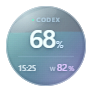
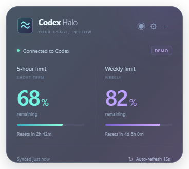

<div align="center">
  
  <h1>Codex Halo</h1>
  <p><strong>Your remaining Codex quota, always in view.</strong></p>
  <p>A transparent Windows desktop widget with flowing waves.<br>See your 5-hour and weekly allowance without reopening the usage menu.</p>
  <p><strong>English</strong> · <a href="README.zh-CN.md">简体中文</a> · <a href="https://github.com/BohaoFU/codex-halo/releases/latest">Download for Windows</a></p>
  <p>  <a href="LICENSE"></a></p>
</div>

## Less clicking. More clarity.

Keep your remaining percentages, usage indicators and reset countdowns beside your work. Codex Halo makes it easier to see how much allowance is left and plan what comes next.

| Water orb | Corner panel |
| :---: | :---: |
|  |  |
| Compact, draggable and always visible | Both windows, progress bars and reset times at a glance |

*Previews use example data: 68% remaining for 5 hours and 82% for the week. No real account usage is shown.*

## Features

- **Two display modes:** a clean 80px water orb with no button strip, or a panel anchored to the bottom-right of your display's work area.
- **Release to snap:** the orb glides to the nearest left or right edge after dragging, preserves its height and remembers the docked position.
- **Readable usage:** water level shows the 5-hour remainder; the lower number shows the weekly remainder inside the glass.
- **Compact footer:** the 5-hour reset time sits at the lower left; weekly remaining percentage sits at the lower right, without a 5h caption.
- **Clean glass material:** soft reflections, a continuous inset edge and restrained cyan/violet waves. No external progress ring or floating particles; rendering follows Windows display scaling.
- **Automatic updates:** refresh every 15 seconds by default, choose 10 / 15 / 30 / 60 seconds, or refresh manually.
- **Transparent gradients:** cyan-to-violet glass, adjustable opacity and optional flowing waves.
- **Chinese and English:** follows your Windows preferred display language, with a manual override.
- **Follows Codex:** checks the desktop client about every 3 seconds, hides both widget modes when it exits, and restores them when it returns. Halo's own background CLI is excluded.
- **Launch at sign-in:** enabled by default for new installs; stays quietly in the tray until Codex starts. Existing explicit opt-outs are preserved.
- **Desktop controls:** always-on-top, drag to move, hide to tray and remembered orb position. A manual hide lasts until you show Halo or restart Codex.
- **Clear connection state:** keep the last reading during an outage, mark it as stale and retry automatically. Unknown values stay `--`.

## Download and start

1. Download **CodexHalo-Windows-x64.zip** from [Releases](https://github.com/BohaoFU/codex-halo/releases/latest).
2. **Extract the entire archive** and run `CodexHalo.exe`. Keep the DLLs, `resources` and other files beside it.
3. Sign in to Codex on your machine with a **ChatGPT account**. Halo reuses Codex's own sign-in.

The portable build requires Windows 10/11 x64 and an available Codex CLI. It does not require a separate Node.js installation. The initial release is not commercially code-signed.

| Action | Result |
| --- | --- |
| Drag the orb | Move it between positions and displays |
| Double-click the orb | Switch to the corner panel |
| Release after dragging | Snap to the closest left or right edge of that display |
| Right-click the widget or tray icon | Show, switch, configure, hide or quit |
| Open settings | Change language, opacity, animation, topmost mode, refresh interval and startup |

Both **Launch at sign-in** and **Follow Codex** can be changed in settings. While following Codex, allowance polling pauses when its desktop app is absent; the tray and settings remain available. This follows the desktop application, including a minimized app, rather than a standalone CLI session. If Windows temporarily cannot inspect processes, Halo keeps the last known state and retries. For a custom desktop installation, set `CODEX_HALO_DESKTOP_EXE` to the GUI executable (not the CLI).

## What the numbers mean

Halo shows Codex subscription usage windows, **not an API cash balance or a lifetime quota**. Remaining percentage is `100 - usedPercent`. The longer window follows what the service returns, usually a week. These indicators track allowance usage, not the completion of an individual coding task.

Polling is not a guarantee of instant updates: the service may report usage with a delay. When a countdown reaches zero, Halo waits for the service to confirm the new allowance instead of inventing a reset.

## Connection and privacy

Halo connects to your local `codex app-server` over standard input/output. It calls `account/rateLimits/read` and listens for usage notifications on its own connection. It does not start inference tasks or ask you to paste an API key. Usage from other Codex windows is picked up by polling.

- Halo does not copy credentials, persist usage readings or record Codex logs.
- Codex uses its existing authentication and service connection; Halo has no separate data-collection server.
- Only widget preferences are saved in `%APPDATA%\CodexHalo\settings.json`.
- The app finds `codex.exe` on PATH, then checks `%LOCALAPPDATA%\OpenAI\Codex\bin`. You can also set `CODEX_HALO_CLI` to the executable's full path.
- API-key-only sign-in generally does not provide these ChatGPT plan limits.

Protocol reference: [Codex App Server](https://learn.chatgpt.com/docs/app-server). This is an independent project, not affiliated with or endorsed by OpenAI.

## Development

Use Node.js 24 (tested):

```powershell
git clone https://github.com/BohaoFU/codex-halo.git
cd codex-halo
npm ci
npm start
```

```powershell
npm test                         # Language, usage conversion, RPC and errors
npm run package                  # Portable app in the sibling CodexHalo directory
npx electron . --smoke-test      # Requires signed-in Codex; checks real usage and UI
```

The UI check writes screenshots and results to `work` two directories above the project by default. Set `CODEX_HALO_TEST_OUTPUT` to choose another output directory. It uses real account usage; do not publish its outputs. GitHub Actions runs unit tests and Windows packaging only.

If your network cannot download Electron, an optional mirror can be set for the current PowerShell session before installation:

```powershell
$env:ELECTRON_MIRROR = 'https://npmmirror.com/mirrors/electron/'
npm ci
```

After moving the portable app, toggle launch-at-sign-in off and on to update its path. Turn it off before deleting the app. To reset preferences, exit Halo and delete its settings file.

## License

[MIT](LICENSE). Issues and improvements are welcome.
