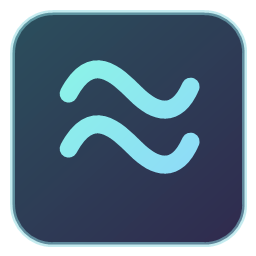
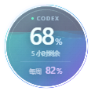
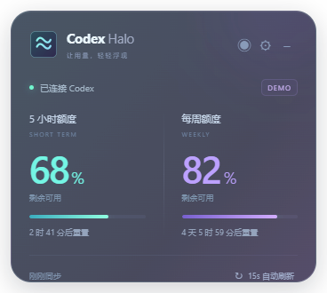

<div align="center">
  
  <h1>Codex Halo</h1>
  <p><strong>剩余额度，抬眼可见。</strong></p>
  <p>一个透明、会流动的 Windows 桌面用量小工具。<br>把 Codex 的 5 小时与每周剩余额度，放到你看得见的地方。</p>
  <p><a href="README.md">English</a> · <strong>简体中文</strong> · <a href="https://github.com/BohaoFU/codex-halo/releases/latest">下载 Windows 版</a></p>
  <p>  <a href="LICENSE"></a></p>
</div>

## 少点一次菜单，多看一眼进度

正在用 Codex 时，不必反复打开用量菜单。Halo 持续展示剩余百分比、用量进度与重置倒计时，帮助你安排接下来的工作。

| 水波悬浮球 | 右下角面板 |
| :---: | :---: |
|  |  |
| 小巧可拖动，随时看剩余量 | 两个周期、进度条和倒计时，一眼看清 |

*预览为示例数据：5 小时剩余 68%，每周剩余 82%；不包含真实账户用量。*

## 功能

- **两种显示方式**：没有按钮条的 104px 纯净水波悬浮球 / 固定在屏幕工作区右下角的面板，随时切换。
- **松手自动靠边**：拖动后平滑吸附到当前屏幕最近的左侧或右侧，保留高度，并记住吸附位置。
- **用量直观可见**：球内水位表示 5 小时剩余，外环及圆内下方数字表示每周剩余。
- **持续自动更新**：默认每 15 秒刷新，可选 10 / 15 / 30 / 60 秒，也可以立即刷新。
- **透明渐变与动画**：青蓝紫玻璃效果，可调整不透明度、关闭流动水波。
- **自动中英文**：跟随 Windows 首选显示语言，也可手动选择中文或 English。
- **跟随 Codex**：约每 3 秒检测桌面客户端，退出时自动隐藏两种悬浮窗，重新打开后恢复；排除 Halo 自己的后台 CLI。
- **开机启动**：新安装默认开启，Codex 未启动时安静留在托盘；保留老版本已明确关闭的偏好。
- **桌面常用操作**：置顶、拖动、托盘隐藏、记住球的位置。手动隐藏后，直到主动显示或重开 Codex 才会恢复。
- **断线状态清楚**：保留上次数据并标记异常，恢复连接后自动重试；未知数据显示 `--`。

## 下载与开始使用

1. 在 [Releases](https://github.com/BohaoFU/codex-halo/releases/latest) 下载 `CodexHalo-Windows-x64.zip`。
2. **完整解压**后双击 `CodexHalo.exe`。请保留旁边的 DLL、`resources` 等文件。
3. 先在本机 Codex 中使用 **ChatGPT 账户**登录，Halo 会复用 Codex 的登录状态。

免安装版不需要另外安装 Node.js；需要 Windows 10/11 x64 和可用的 Codex CLI。首次发布的程序没有商业代码签名。

| 操作 | 效果 |
| --- | --- |
| 拖动球体 | 移动悬浮球，支持多显示器 |
| 双击球体 | 切换到右下角面板 |
| 拖动后松手 | 吸附到当前屏幕最近的左侧或右侧 |
| 右键窗口或托盘图标 | 显示、切换、设置、隐藏或退出 |
| 打开设置 | 调整语言、透明度、动画、置顶、刷新间隔及开机启动 |

设置中可分别关闭“开机启动”和“跟随 Codex 显示”。跟随模式下，Codex 桌面客户端未运行时暂停额度轮询，托盘及设置仍可使用。最小化的客户端仍算正在运行；单独的 CLI 会话不触发显示。Windows 暂时无法检查进程时保留上次状态并重试。非标准安装可将 `CODEX_HALO_DESKTOP_EXE` 指向桌面 GUI 可执行文件，请勿指向 CLI。

## 额度是什么

Halo 展示的是 Codex 套餐用量窗口，**不是 API 账户的现金余额，也不是终身总额度**。剩余百分比按服务返回的 `100 - usedPercent` 计算；长期窗口按实际返回的周期显示，通常为每周额度。它展示用量进度，不追踪单个编程任务的完成进度。

自动刷新不是逐秒实时保证，服务端可能延迟更新。倒计时到零后，仍等待服务确认新额度，不会自行补满数字。

## 连接与隐私

Halo 使用本机 `codex app-server` 的标准输入输出连接，读取 `account/rateLimits/read` 并监听自己的连接收到的额度更新通知。它不会创建推理任务，也不要求复制 API key。其他 Codex 窗口的用量变化通过轮询获取。

- 程序本身不复制凭据，不持久化用量，也不记录 Codex 日志。
- 用量通过 Codex 原有的登录及服务连接获取；Halo 没有自己的数据收集服务器。
- 仅外观和显示设置保存在 `%APPDATA%\CodexHalo\settings.json`。
- 优先从 PATH 查找 `codex.exe`，再查找 `%LOCALAPPDATA%\OpenAI\Codex\bin`。也可设置环境变量 `CODEX_HALO_CLI` 指向可执行文件。
- API key 登录通常不提供这类 ChatGPT 套餐额度。

协议参考：[Codex App Server](https://learn.chatgpt.com/docs/app-server)。本项目独立开发，与 OpenAI 无隶属或背书关系。

## 本地开发

使用 Node.js 24（已验证）：

```powershell
git clone https://github.com/BohaoFU/codex-halo.git
cd codex-halo
npm ci
npm start
```

```powershell
npm test                         # 语言、额度换算、RPC 与错误处理
npm run package                  # 在相邻 CodexHalo 目录生成免安装程序
npx electron . --smoke-test      # 需要已登录的 Codex；读取真实额度并检查界面
```

界面检查的截图和结果默认写到项目上两级的 `work` 目录；可通过 `CODEX_HALO_TEST_OUTPUT` 指定输出路径。此检查使用真实账户数据，请勿将其结果公开。GitHub Actions 只执行单元测试与 Windows 打包。

若当前网络无法下载 Electron，可在安装前给当前 PowerShell 设置镜像：

```powershell
$env:ELECTRON_MIRROR = 'https://npmmirror.com/mirrors/electron/'
npm ci
```

移动程序后，请重新关闭再开启“开机启动”以更新路径。删除程序前先关闭该选项；退出后删除设置文件可恢复默认值。

## 许可

[MIT](LICENSE)。欢迎提交问题和改进建议。
