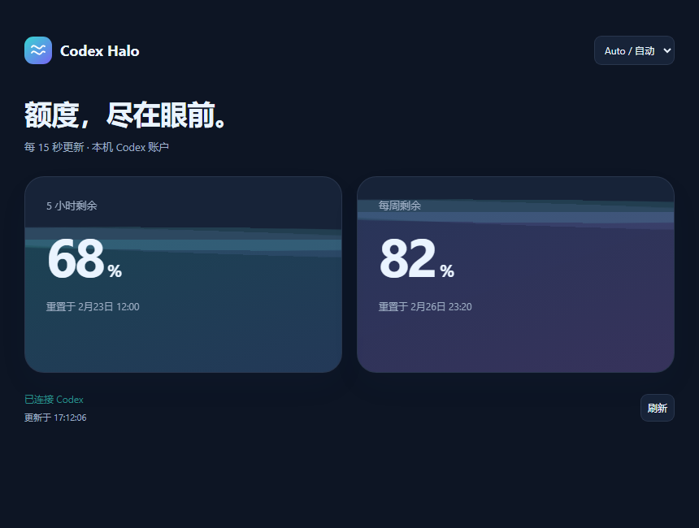

# Codex Halo native panel · 原生面板试验

Experimental local MCP plugin for Codex desktop. It advertises a **global navigation entry** and a **conversation panel entry**, backed by the existing read-only Halo quota client. The host chooses navigation placement. Placement in the screenshot's lower blank rail area has not been confirmed. The navigation icon does not display live percentages.

本地 MCP 插件试验：声明左侧全局入口和聊天面板入口，点击后查看 5 小时及每周剩余额度。具体位置由 Codex 排列，尚未确认会出现在截图标出的左栏空白处；入口图标本身不显示实时百分比。

- Chinese/English with automatic host/system language; refreshes every 15 seconds while visible.
- Double-wave icon, animated quota cards, reset times and light/dark themes.
- Reads `account/rateLimits/read` from the local Codex account. No model inference, sign-in changes or credential exports.
- Requires Node.js 20+ and an installed/signed-in Codex CLI. Desktop-only, experimental; not an OpenAI directory submission.
- 与现有 Windows 悬浮球独立，支持中英文、15 秒更新、双波纹图标、浅深色和重置时间。



Preview uses a test host and synthetic data; it is not evidence of a native sidebar entry. 上图为模拟宿主预览，使用示例数据。

## Install / 安装

Clone this branch and register the prebuilt marketplace; no npm build is required:

```powershell
git clone --branch experiment/native-sidebar https://github.com/BohaoFU/codex-halo.git
cd codex-halo
codex plugin marketplace add ./native-plugin --json
codex plugin add codex-halo-panel@codex-halo-lab --json
codex plugin list --json
```

Reopen Codex after installation. Look for **Codex Halo** in global navigation or its overflow menu. If the host exposes only conversation tools, select the plugin in a new chat and ask to open its quota panel. Installation and successful MCP calls alone do not prove that the desktop navigation entry rendered.

安装后重新打开 Codex，检查左侧导航或更多菜单中的 **Codex Halo**。如果仅加载了聊天工具，在新聊天选择该插件并打开用量面板。当前完成了安装、真实额度读取和模拟宿主 UI 验证；原生左栏显示仍待实际确认。

```powershell
codex plugin remove codex-halo-panel@codex-halo-lab
```

## Build / 开发

```powershell
cd plugin-panel
npm ci
npm run build
npm test
```

The build writes `../native-plugin`, including bundled server/UI code and dependency licenses. `HALO_PLUGIN_NODE_MODULES` optionally points to an existing dependency directory; `HALO_PLUGIN_MARKETPLACE_OUTPUT` overrides the output for isolated testing.

Protocol checks cover global/thread metadata, navigation icon, HTML resource, real quota reads and refresh caching. UI was tested using the actual MCP App handshake and tool bridge in an Electron test host at wide/narrow widths in Chinese and English. Preview screenshots use synthetic 68%/82% quota.

See [entrypoints documentation](https://developers.openai.com/plugins/build/extensions) and [local plugin packaging](https://developers.openai.com/plugins/build/plugins).
